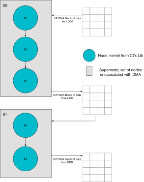
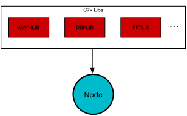
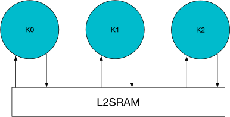
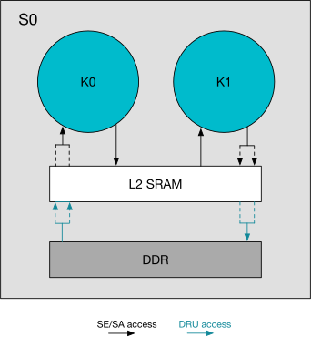
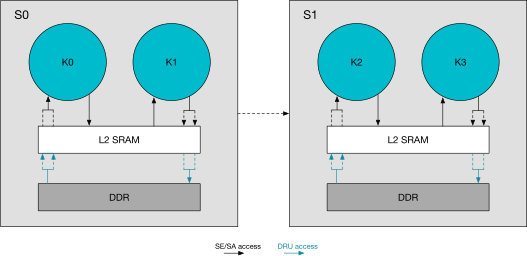
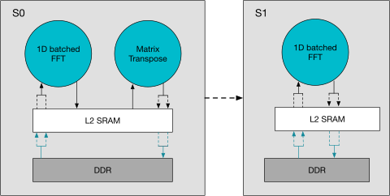

:icon: material/cog

Architecture
============

Introduction
------------

TISP (TI Signal Processing) is a software library that strives to abstract away
the software and hardware complexity of programming the C7x.

A typical signal chain is shown in the figure below.  Basically, a collection of
kernels (nodes) stitched together.  A set of these kernels in the signal chain are
grouped for DMA (supernode).  Typically, in user applications, the complete data
needs to be processed by nodes encapsulated inside the supernode before calling
the next node in the signal chain.  Nodes (kernels) themselves perform compute
using data in L2SRAM.  Data movement from DDR to L2SRAM (DMA) is accomplished via
DRU (Data Routing Unit) available within the C7x.

   Typical Signal Chain

Node-Level Abstraction
----------------------

In order to create a common baseline for kernels from various libraries, TISP
first creates a virtual class :cpp:class:`TISP::VirtualOp`.  Doing so allows a
class to be created for every kernel in a given library that is derived from this
base virtual class.  Each node can be identified by a unique ``nodeName`` and
``nodeId``, which are useful for debugging, profiling, and visualisation purposes.

.. note::

   Node-level abstraction is not available for all kernels of a given library.
   Please refer to the DSP Nodes API page for supported nodes.

   Node-Level Abstraction

Employing this methodology enables us to string a bunch of nodes together through
a custom vector datatype ``TISP::opVec``.  An example of the matrix
transpose kernel from DSPLIB described as a class ``TISP::DSPLIB::MatTrans``
is shown below.  Please refer to the DSPLIB documentation for more details about
the data structures pertaining to DSPLIB.

.. literalinclude:: ../../src/DSPLIB/TISP_matTrans.cpp
   :language: cpp
   :linenos:
   :start-after: //! [DSPLIB_MatTrans constructor]
   :end-before: //! [DSPLIB_MatTrans constructor]

Connecting and Executing Nodes
-------------------------------

The data flow while connecting nodes is depicted through the pointer addresses
shared between the nodes when creating a node through its class constructor.
Whilst the compute flow is represented via the order in which the nodes are pushed
back into ``TISP::opVec``.  Thus allowing us to create any given signal
chain as a graph.

   Connecting Nodes

An example code snippet is shown below for connecting and creating nodes together,
taken from ``TISP_fft1dBatched_test.cpp``.  After creating nodes via constructors
and pushing them back into ``TISP::opVec`` with the desired order,
``TISP::execute::graph`` can be called to iterate through the vector of
nodes to call the execute function pertaining to a given node.

.. literalinclude:: ../../test/FFTLIB/TISP_fft1dBatched/TISP_fft1dBatched_test.cpp
   :language: cpp
   :linenos:
   :start-after: //! [connecting nodes example]
   :end-before: //! [connecting nodes example]

Supernode-Level Abstraction
----------------------------

TISP employs a similar strategy for supernodes.  In the case of supernodes,
there are various variants such as ``TISP::SuperNode::I2dToO2d``,
``TISP::SuperNode::I2dToO2dDiffDims``, etc.  Further styles of supernodes
will be added as the scope of the library expands.  Note that variants of supernode
are derived from a non-virtual base class ``TISP::SuperNode::BaseSuperNode``.

   Supernode-Level Abstraction

An example code snippet for one-input, one-output supernode is shown below.  The
DRU parameters are programmed to access the input and output DDR space in a 2D form.

.. literalinclude:: ../../src/superNode/TISP_i2d_to_o2d.cpp
   :language: cpp
   :linenos:
   :start-after: //! [supernode example]
   :end-before: //! [supernode example]

Connecting and Executing Supernodes
-------------------------------------

Connecting and executing supernodes is also similar to nodes.  The execution order
of the kernels inside the supernode is determined by the
``TISP::opVec`` datastructure passed to the supernode constructor as
argument.  Each supernode keeps track of the number of blocks it processes, which
is useful for performance analysis and profiling.

   Connecting Supernodes

Please refer to the 2D FFT Example section below for more details.

2D FFT Example
--------------

The example has two supernodes connected together as shown in the figure below.

   2D FFT Example

Shown below is the code snippet that depicts the 2D FFT graph.  The code snippet
is taken from ``TISP_fft2d_superNode_test.cpp``.

.. literalinclude:: ../../test/FFTLIB/TISP_fft2d_superNode/TISP_fft2d_superNode_test.cpp
   :language: cpp
   :linenos:
   :start-after: //! [2D FFT Example]
   :end-before: //! [2D FFT Example]

The use of smart pointers allows us to destroy the graph and the memory allocated
for the nodes within the graph with minimal code overhead.

L2SRAM Memory Management
-------------------------

On TI C7x DSPs, L2SRAM is the fastest on-chip memory (zero wait states), while
DDR access incurs approximately 150 cycle latency.  TISP manages L2SRAM allocation
through a simple mechanism: you give it a byte array, and it hands back aligned
chunks from that array on demand.  No operating system heap, no fragmentation —
just a pointer that moves forward through a fixed-size buffer.

The class that implements this is ``TISP::BumpAllocator``.  It is
compliant with MISRA C++:2023 Rule 21.6.2, AUTOSAR A18-5-10, and SEI CERT
MEM54-CPP.

Bump Allocator
^^^^^^^^^^^^^^

Think of ``TISP::BumpAllocator`` like a roll of tape.  You pull off what
you need (allocate), and the roll gets shorter.  You can rewind the whole roll at
once (reset), but you cannot put a piece back in the middle.

Each allocation returns a smart pointer (``TISP::ArenaPtr``) that
automatically releases its memory when it goes out of scope.  You choose the
alignment you need — 32-byte, 64-byte, or custom — depending on what the DSP
vector unit requires.

.. code-block:: cpp

   // Step 1: Declare a byte array in L2SRAM (the "roll of tape")
   __attribute__((section(".l2sramData"), aligned(128))) uint8_t myArena[64 * 1024];

   // Step 2: Hand it to the allocator
   TISP::BumpAllocator alloc(myArena, sizeof(myArena));

   // Step 3: Pull off what you need
   TISP::ArenaPtr<float> buf = alloc.allocate64ByteAligned<float>(1024);

Arena Ownership Model
^^^^^^^^^^^^^^^^^^^^^

TISP uses two separate arenas (byte arrays).  Who owns each one determines who is
responsible for sizing and declaring it:

.. list-table::
   :header-rows: 1
   :widths: 20 30 50

   * - Arena
     - Who owns it?
     - What is it for?
   * - **Node arena**
     - Your application
     - You declare the byte array and decide how big it is based on your signal chain.
   * - **Twiddle arena**
     - TISP library
     - A fixed 32 KB internal array used by FFT nodes.  You never touch it directly.

The library provides the allocator class (``TISP::BumpAllocator``).  Your
application provides both the node arena memory and the twiddle arena memory —
you declare the backing arrays and choose their section placement at link time.
The function ``TISP::twiddleAllocator()`` returns a reference to the
allocator that FFT nodes use internally.

On target hardware, the twiddle arena is typically placed in L2SRAM (e.g.
``.tisp_twiddle_arena`` section) for zero-wait-state access.  On a PC (host
emulation), the same externally-provided buffer compiles as a plain aligned
array — same API, same behaviour, no hardware dependency.

Twiddle Factor Arena
^^^^^^^^^^^^^^^^^^^^

FFT algorithms need precomputed trigonometric constants called "twiddle factors."
These are purely a function of the FFT size — compute them once, reuse them on
every frame.  TISP handles this internally so the application does not need to
know anything about twiddle factor allocation.

When you create an FFT node (e.g., ``FFT1dBatched``), the constructor allocates
twiddle factors from the library-owned twiddle arena behind the scenes:

.. code-block:: cpp

   // Inside FFT1dBatched constructor (internal -- app never calls this directly):
   _pW = twiddleAllocator().allocate64ByteAligned<T>(_numPoints * 2);
   tw_gen();  // Fill in the twiddle factor values

The ``TISP::twiddleAllocator()`` function is a one-liner that returns a
reference to a pre-existing allocator.  Here is the complete implementation —
there is nothing hidden:

.. code-block:: cpp

   // src/common/TISP_bump_allocator.cpp

   // The backing array is declared by the application (extern linkage).
   // See test/common/TISP_app_arena_default_config.cpp for the default:
   //   __attribute__((section(".tisp_twiddle_arena"), aligned(64)))
   //   uint8_t tisp_twiddleArenaBuffer[32U * 1024U];
   extern uint8_t tisp_twiddleArenaBuffer[];
   extern const size_t tisp_twiddleArenaSize;

   // Allocator that manages the byte array above -- created once at startup
   static BumpAllocator twiddleAllocatorInstance(
       tisp_twiddleArenaBuffer, tisp_twiddleArenaSize, kTwiddleAlignment);

   // Returns a reference to the allocator above -- this is the entire function
   BumpAllocator &TISP::twiddleAllocator() { return twiddleAllocatorInstance; }

Why this design?

- **Always available**: the byte array and allocator exist for the entire program
  lifetime, so FFT twiddle factors are always valid — no use-after-free.
- **No external dependencies**: pure C++14 — no TI SDK heap calls, no OS
  allocator, no fragmentation risk.
- **Zero cost at runtime**: twiddle factors are accessed as plain pointers during
  signal processing.  The smart-pointer bookkeeping only runs when you create or
  destroy an FFT node, not on every frame.

Performance Profiling
---------------------

TISP includes a comprehensive profiling system through the ``NodeProfiler`` class
(global scope) that allows you to measure and analyse the performance of both
individual nodes and supernodes.  The profiler captures cycle counts for each node
execution and provides detailed analytics for performance optimisation.

Key profiling features include:

- Cycle count measurement for individual nodes and supernodes
- Node identification via ``nodeName`` and ``nodeId`` for easy tracking
- Block count tracking for supernodes to analyse per-block performance
- JSON output for detailed performance analysis
- Excel report generation via the ``json_to_xlsx_converter.py`` tool

The profiling system helps identify performance bottlenecks and provides insights
into the efficiency of supernode execution by comparing actual cycles with
theoretical cycles based on the sum of node cycles multiplied by the number of
blocks processed.

Creating and Executing a Graph
------------------------------

The example below, from an audio signal chain, demonstrates creating nodes with
names and IDs and executing the assembled graph.  (The same example also feeds
the profiler described above.)

Creating the Graph
^^^^^^^^^^^^^^^^^^

.. literalinclude:: ../../test/audio_signal_chain/TISP_cascadeBiquad_FIR/TISP_cascadeBiquad_FIR_test.cpp
   :language: cpp
   :linenos:
   :start-after: //! [create_graph]
   :end-before: //! [create_graph]

Executing the Graph
^^^^^^^^^^^^^^^^^^^

.. literalinclude:: ../../test/audio_signal_chain/TISP_cascadeBiquad_FIR/TISP_cascadeBiquad_FIR_test.cpp
   :language: cpp
   :linenos:
   :start-after: //! [execute_graph]
   :end-before: //! [execute_graph]
